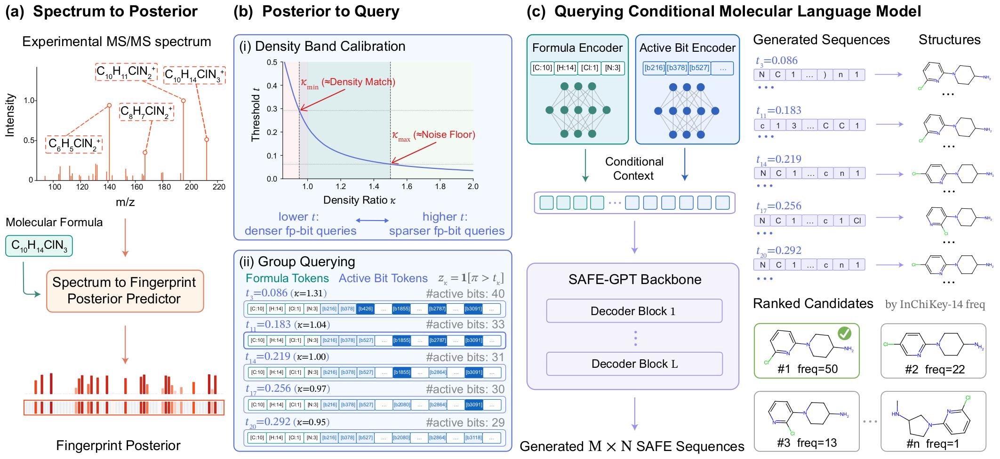

# MS-GPT

**MS-GPT: Rethinking MS/MS De Novo Structure Elucidation as
Spectrum-Induced Posterior Querying of a Molecule-Language Model**

MS-GPT formulates known-formula MS/MS *de novo* structure elucidation as
spectrum-induced posterior querying of a conditional molecule-language model.
MS-GPT constructs a calibrated band of posterior-derived queries, generates
candidates across the band, and ranks them by generation-frequency consensus.



The 150.1M-parameter conditional molecule-language model is pretrained once on a
molecule-only corpus with oracle fingerprints and formulas, then shared across
NPLIB1 and MassSpecGym. Each benchmark has a dataset-specific MIST spectrum
encoder and a lightweight posterior-aligned LoRA adapter.

## Method

### Spectrum-induced posterior querying

A frozen, dataset-specific MIST encoder maps an MS/MS spectrum and its known
formula to a 4096-bit fingerprint posterior. Active-bit density band calibration
derives dataset-specific threshold intervals from the corresponding encoder
training split.

At the default candidate-pool size `B = 100`, MS-GPT forms `M = 20` thresholded
queries and samples `N = 5` SAFE sequences per query. Generated structures are
grouped by InChIKey-14 and ranked by generation frequency.

### Molecule-only pretraining and posterior-aligned adaptation

Formula-grouped pretraining maps oracle fingerprint-formula queries to target
SAFE sequences without spectra. The main model is trained for two epochs on
100,007,359 molecule records after excluding connectivity-equivalent structures
from the validation and test splits of both benchmarks.

Posterior-aligned adaptation samples thresholded queries from the target
spectral domain and trains LoRA modules only in the query-reading pathway. The
formula encoder, SAFE-GPT backbone, language-model head, and all other pretrained
weights remain frozen. A teacher-forced cross-entropy objective is paired with a
KL anchor to the frozen model.

## Results

The paper evaluates exact connectivity recovery under the known-formula protocol
with `B = 100`. Exact match compares the first 14 InChIKey characters; Tanimoto
reports the maximum radius-2 Morgan-fingerprint similarity among the top-ranked
candidates.

| Benchmark | Top-1 accuracy (%) | Top-1 Tanimoto | Top-10 accuracy (%) | Top-10 Tanimoto |
|---|---:|---:|---:|---:|
| NPLIB1 | **29.76** | **0.61** | **41.07** | **0.67** |
| MassSpecGym | **23.91** | **0.52** | **28.65** | **0.54** |

Component ablations retain the same budget of 100 decoder samples per spectrum.
Query-construction controls below are evaluated without posterior-aligned
adaptation. Cells report Top-1/Top-10 exact-match accuracy (%).

| Variant | NPLIB1 | MassSpecGym |
|---|---:|---:|
| MS-GPT | **29.76/41.07** | **23.91/28.65** |
| MS-GPT-Base (without posterior-aligned adaptation) | 28.42/33.78 | 22.77/26.96 |
| Density-match point query | 24.40/28.87 | 20.08/22.80 |
| Validation-F1 point query | 22.47/25.30 | 19.58/22.78 |
| Validation-cosine point query | 21.88/24.55 | 19.42/22.56 |

## Reproduction

An NVIDIA RTX 6000 Ada GPU is recommended for reproduction.

### 1. Install the environment

```bash
git clone https://github.com/VIKI623/MS-GPT.git
cd MS-GPT
bash env/setup.sh ms_gpt
conda activate ms_gpt
cp env/.env.example .env
```

Edit `.env` to point to the released checkpoints and benchmark data, then load
the variables:

```bash
set -a
source .env
set +a
```

The setup script installs the CUDA 12.1 PyTorch wheel. Install the matching
PyTorch build separately if the host has a different CUDA version.

### 2. Place the released assets

Download the released asset bundle from Zenodo (**download link to be added**)
and extract it into the repository root:

```text
checkpoints/
├── mlm/ms_gpt_mlm.pt
├── mist/{mist_nplib1.pt,mist_massspecgym.pt}
├── posterior_aligned_adapters/{nplib1,massspecgym}/
└── safe_gpt_base/
data/
├── benchmarks/{nplib1,massspecgym}/
└── pretrain_100m/                         # optional; pretraining only
```

### 3. Build fingerprint-posterior caches

```bash
bash data_preparation/build_posterior_cache.sh
bash data_preparation/compute_density_calibration.sh
```

### 4. Reproduce the reported evaluations

```bash
# Main results
bash scripts/launch/reproduce_main_results.sh all

# Component ablations
bash scripts/launch/reproduce_ablation_results.sh all
```

Pass `nplib1` or `massspecgym` instead of `all` to evaluate one benchmark.
Generated candidates and metrics are written to `eval_results/`.

MCES is evaluated on CPU HPC nodes after candidate generation:

```bash
sbatch scripts/launch/evaluate_mces.slurm \
  nplib1 eval_results/nplib1_main/post.jsonl
```

## License

The code is released under the [Apache License 2.0](LICENSE).
